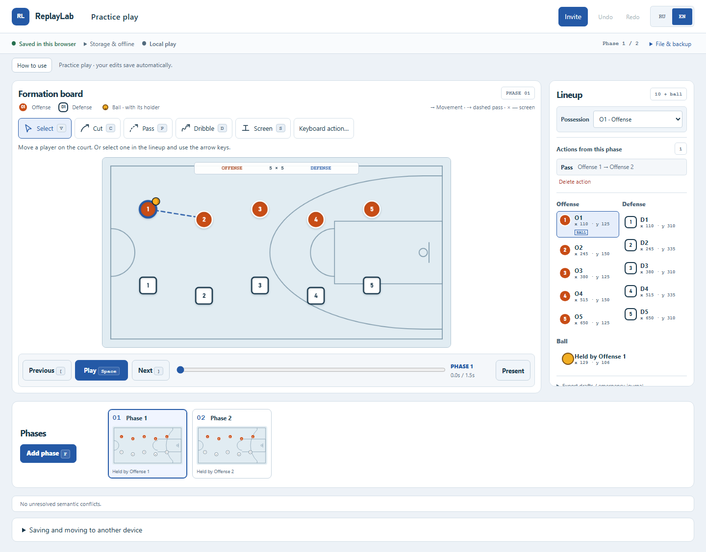

# ReplayLab

[](https://github.com/godaylor/replaylab/actions/workflows/replaylab.yml)

**[Open ReplayLab](https://replaylab-godaylor.onrender.com)** · [Architecture](docs/ARCHITECTURE.md) · [Deployment](docs/RELEASE.md) · [Portfolio handoff](PORTFOLIO_HANDOFF.md)

Локальный редактор баскетбольных комбинаций: расставьте игроков, добавьте фазы, нарисуйте передачу или движение и проиграйте результат. Два тренера могут редактировать одну комбинацию, продолжать работу офлайн и после подключения явно разрешать конфликты.

Local-first multiplayer editor for animated basketball plays. RU is the default; EN is available in the app. One half-court, ten players, a derived ball, 2–12 phases, four tactical actions, rich coaching cues and local-only undo.

Desktop supports full authoring. Tablet supports playback, player movement and cue editing. Mobile supports playback and semantic review. IndexedDB is authoritative; the server stores a recoverable network copy.



[Design concepts, mobile screens and before/after](docs/design/REVIEW.md) · [Current availability and verification](docs/PRODUCTION_VERIFICATION.md)

## Make a play

1. Choose **Open example** to try a separate practice play, or **Create a play** for your own combination.
2. Select a phase, draw a cut, dribble, pass or screen, and add the next phase.
3. Add a coaching cue, scrub the timeline, then press Play.
4. Edits save automatically in this browser. Return home to reopen recent work. **File & backup → Recovery file** downloads a complete portable copy.
5. Choose **Invite → Create collaborative room** to create a private shared copy.
   Open that room yourself, then send the edit or view link to a collaborator.
   The local original is preserved. Anyone with a private link has its access.

## What works

- Original canvas court with pointer and keyboard authoring, 2–12 phases and four tactical actions.
- Deterministic animation, scrubbing, presenter/follow mode and reduced-motion playback.
- Rich per-phase coaching cues and one local undo history across text and court edits.
- Automatic local persistence, cold offline launch, crash journal and recoverable exports.
- Private collaborative rooms, separate edit/view capabilities, presence and remote updates.
- Explicit review of concurrent pose/path/possession intentions after reconnection.
- RU/EN interface, responsive review surfaces and a semantic canvas companion.

## Как начать

Откройте [ReplayLab](https://replaylab-godaylor.onrender.com/) и выберите
**Открыть пример** или **Создать комбинацию**. **Как пользоваться** запускает
знакомство на отдельной учебной копии: обозначения → перемещение → движение →
воспроизведение → отмена → экспорт → повторное открытие. Новый пример не меняет
старые комбинации; изменения учебной копии сохраняются в «Недавних».

Красные круглые O1–O5 — атака, голубые квадратные D1–D5 — защита, жёлтый кружок —
мяч. Пунктир обозначает передачу; стрелка — движение, крестик — заслон.
Отпустите указатель, чтобы завершить рисование; Escape отменяет черновик.
Если игроки рядом, выбирайте точного игрока в списке «Расстановка».
Удалённое действие можно вернуть через «Отменить».

Изменения сохраняются **в этом браузере**. Для переноса полной независимой копии
используйте **Файл восстановления → Открыть восстановление…** на другом
устройстве. Обычный **Экспорт JSON** предназначен для чтения, а не для этого импорта.
Очистка данных браузера удаляет локальные копии; храните отдельный экспорт.

Аккаунтов и регистрации нет. **Пригласить** создаёт совместную комнату с копией
текущего документа. Ссылки **Редактирование** и **Только просмотр** дают разные
права каждому, кто ими владеет. Сохраните их приватно: восстановления через
аккаунт нет. Локальный оригинал и комната затем живут отдельно.
На телефоне доступны просмотр, фазы и воспроизведение; полное редактирование —
на компьютере, на планшете — перемещение игроков и подсказки.

## Stack

TypeScript, React 19, Vite 7, Yjs 13.6.21, four vendored MIT BlockSuite framework
packages (global/store/std/sync), Lit, RxJS, y-protocols, fractional-indexing,
IndexedDB, BroadcastChannel and a service worker. Node 22 serves HTTP and the
product-owned WebSocket protocol through `ws`. Supabase Postgres stores hosted
room snapshots through its server-only REST API. Render runs the single Docker
service. Yarn 4, Playwright, axe-core and GitHub Actions verify the release.

The free portfolio deployment runs the HTTPS/WebSocket process on Render and stores private room snapshots in Supabase Postgres. No user document is written to Render's ephemeral filesystem. The checked-in `render.yaml` fixes the service to the free compute plan and prompts for the server-only database credentials instead of committing them.

Render Free sleeps when idle, so the first visit can take about a minute. Room
creation is bounded to 32 stored rooms and six requests per minute per server.
There are no accounts, public room directory, analytics collection or payments.

An additive, versioned emergency journal retains committed gestures and unapplied title/cue drafts across abrupt renderer closure. Existing local plays are backed up before adoption; corrupt or unknown records are preserved for read-only recovery/export. See [recovery contract](docs/EMERGENCY_JOURNAL.md). Browser data clearing or complete storage failure still requires an independent export/backup.

## Local setup

Use Node 22 (`>=22.12 <23`) and the repository's Yarn 4.18.0. Run from the repository root:

```sh
node .yarn/releases/yarn-4.18.0.cjs workspaces focus @replaylab/foundation-proof
cd packages/replaylab/foundation
node ../../../.yarn/releases/yarn-4.18.0.cjs build
node ../../../.yarn/releases/yarn-4.18.0.cjs build:server
node ../../../.yarn/releases/yarn-4.18.0.cjs start
```

Open http://127.0.0.1:32400. The server serves the app and `/sync` on the same port. Check port availability first; it fails if the port is occupied. `dev` also uses 32400, so run only one of them. No full monorepo or upstream Docker stack is needed.

Use **Invite** in the running app to create a private room. The offline
`room:create <room-id>` operator command remains available for filesystem-backed
installations. Do not publish bearer links. See [release instructions](docs/RELEASE.md)
for persistence, environment variables, backups and Docker.

## Verification

```sh
# From packages/replaylab/foundation; install the pinned Chromium once:
node ../../../node_modules/@playwright/test/cli.js install chromium
node ../../../.yarn/releases/yarn-4.18.0.cjs verify:release
```

Checks use 32410–32414, one worker, isolated browser profiles and temporary rooms. `verify:release` checks free ports, typechecks, builds client/server, runs the product tests, audits provenance/licenses and prepares `release-dist`. This directory is the deployment artifact; do not upload an upstream checkout or raw development `dist`.

Evidence lives in [foundation/evidence](packages/replaylab/foundation/evidence). [PLAN.md](PLAN.md) records dated results and open manual reviews. Render is connected to this repository's `main` branch with deployment after checks pass. Actual hosted checks are visible in the badge above.

## Accessibility and review

[Manual release review](docs/RELEASE.md#manual-release-review) covers screen readers, keyboard, zoom, touch and collaboration. Automated checks do not substitute for human/device review; unavailable reviews remain open.

## Provenance

This is the standalone owner repository, with five workspaces and one ReplayLab CI workflow. The [source inventory](SOURCE_STATE.json) preserves the pinned origin and hashes of the allowed kernel. Historical transformation documents describe the original audit context; they are not additional product dependencies.

The author's work is the ReplayLab shell, basketball domain and commands, adapters,
canvas projection, timeline/playback, semantic conflict handling, recovery, RU/EN
UX, original room protocol/server, deployment and tests. BlockSuite's four retained
framework packages remain third-party implementation, with their original notices.
ReplayLab does not ship the AFFiNE application shell, backend, network protocol or
branding and is not endorsed by AFFiNE/TOEVERYTHING.

The composite [LICENSE](LICENSE), [LICENSE-MIT](LICENSE-MIT), nested notices and [license boundaries](docs/LICENSE_BOUNDARIES.md) remain authoritative. The entire repository is not uniformly MIT. The release package includes the SBOM, license inventory and full third-party notices at `/legal/THIRD_PARTY_NOTICES.md`. “ReplayLab” remains a working title pending independent mark/domain clearance.
