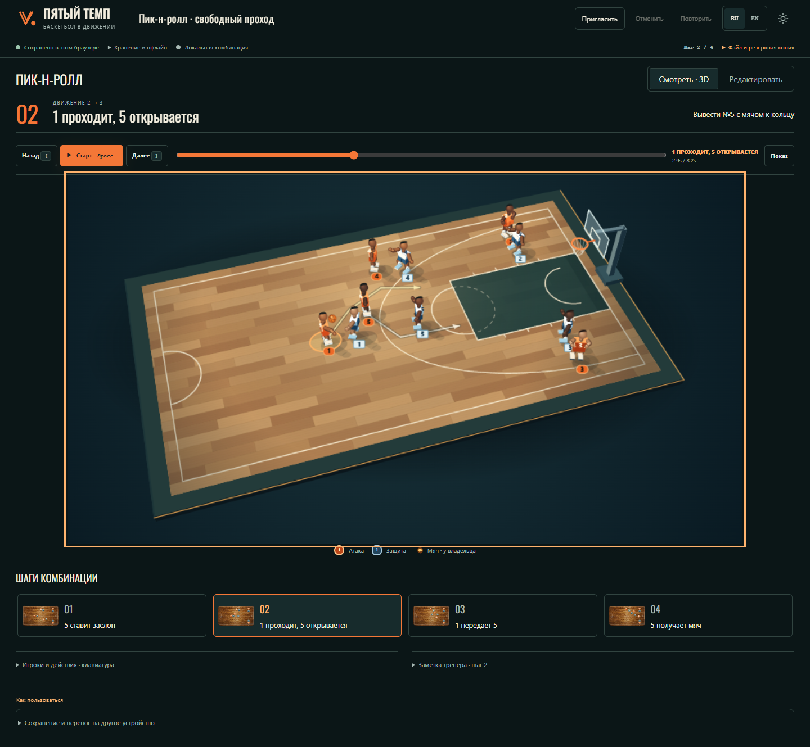

# «Пятый темп»: результат переработки, 18 октября 2026

[Открыть приложение](https://replaylab-godaylor.onrender.com/) ·
[Локальная версия](http://127.0.0.1:32400/) ·
[32 секунды реальной работы](design/coach3d-motion.webm)

Приложение помогает показать одну баскетбольную комбинацию: где стоят игроки,
кто движется и куда идёт мяч. Главная и просмотр используют одну объёмную сцену.
Для точного рисования кнопка «Редактировать» открывает площадку сверху.

## Что теперь делать первым

1. **Смотреть пример** — открывается собственная локальная копия пик-н-ролла.
   Цель: вывести игрока №5 с мячом к кольцу. Оранжевые атакуют, светлые защищаются.
2. **Старт** — посмотреть движение; шаги объясняют конкретные действия:
   №5 ставит заслон → №1 проходит, №5 открывается → передача №5 → получение мяча.
3. **Редактировать** — переместить игрока и провести действие от него по площадке.
   Важно различать изменение расстановки и траекторию следующего движения.
4. **Добавить шаг**, воспроизвести результат и открыть его снова из недавних.
   Изменения сохраняются автоматически на устройстве; отдельная кнопка сохранения
   не требуется. Резервная копия и восстановление доступны через меню файла.

Управление клавиатурой, отмена, rich-заметки и прежние документы сохранены.
На телефоне доступны просмотр, выбор шага и чтение заметок; полное рисование
остаётся на компьютере. Узкое окно с мышью сохраняет авторские возможности.

## Макет и работающий интерфейс

Это визуальный ориентир. Реальные игроки стилизованы и менее детализированы;
они построены из собственной процедурной геометрии и движутся по данным
комбинации. Сгенерированная картинка не подменяет интерактивную площадку.

[До/после, редактор, обе темы и мобильные экраны](design/COACH_WORKBENCH_REVIEW.md).
В ходе сравнения перенесены выше кнопки воспроизведения, сокращена мобильная
шапка, четыре шага размещены в два столбца. После практического прогона также
исправлены неверный игрок в начале рисования и устаревшие подписи после изменения
или удаления действия.

## Где находится комбинация

| Вариант | Что это означает |
| --- | --- |
| Локальная комбинация | Сохраняется в этом браузере. Её обычный адрес не переносит данные на другое устройство. |
| Общая комната | Отдельная совместная копия с приватными ссылками доступа. Локальные изменения доступны при потере сети и синхронизируются после восстановления. |
| Ссылка для просмотра | Доступ к общей комнате без права менять игроков, шаги и название. |

Старые комбинации и комнаты не сбрасывались. Проверки создавали отдельные
синтетические документы и приватные комнаты.

## Проверки и публикация

**Опубликовано и проверено:** коммит приложения `cd6fd3a`,
[CI 39071486059 — success](https://github.com/godaylor/replaylab/actions/runs/39071486059),
[Render — Deploy succeeded](https://dashboard.render.com/web/srv-dah9cq1t0dsc73f4ou50/deploys/dep-db9umtfbtjjs73d4ffvg).
HTML, основной JavaScript и CSS публичного сайта побайтно совпадают с проверенным
локальным пакетом. Подробные идентификаторы и результаты находятся в
[техническом отчёте](PRODUCTION_VERIFICATION.md).

| Проверка | Результат |
| --- | --- |
| Полный локальный Chromium | 111/111, без падений, нестабильных тестов и пропусков |
| Немедленное закрытие и восстановление | 10/10 |
| WebKit | 26/26 целевых проверок и 2/2 дополнительных регрессии подписей |
| Максимальная 3D-сцена, 30 секунд | 12 шагов, 10 игроков, 30 траекторий; около 60 FPS, p95 кадра 16,8 мс |
| Лицензии и границы зависимостей | Технический аудит пройден; запрещённых модулей 0; gzip JS 243 779 байт |
| Финальные Node и Docker | По 4/4, включая резервную копию и восстановление |
| Публичные desktop RU/EN и две совместные сессии | PASS: редактирование, перезагрузка, офлайн-открытие, восстановление связи и отмена обоих участников |
| Публичные мобильные RU/EN | PASS: 390 × 844, касания, просмотр, шаги, сохранение языка, без горизонтальной прокрутки и обнаруженных ошибок консоли |

[Главная](design/public-coach3d-home.png) · [Редактор](design/public-coach3d-editor.png) ·
[Телефон RU](design/public-coach3d-mobile-ru.png) · [Телефон EN](design/public-coach3d-mobile-en.png).
Публичная проверка сначала обнаружила 404 для отсутствующей иконки вкладки.
Добавлен собственный фирменный знак; повторный прогон прошёл без подавления ошибки.

Практическая проверка — моделирование задачи тренера, а не исследование на
живой тренировке. Публичный desktop-прогон проверяет открытие примера, просмотр,
перемещение клавиатурой, рисование, добавление шага, Undo/Redo, перезагрузку и
повторное открытие на двух языках. Офлайн-проверка закрывает вкладку и открывает
новую в уже подготовленном браузерном контексте; первый визит без сети она
не обещает. Совместный сценарий проверяет двух независимых участников,
отключение, параллельные изменения, восстановление связи и локальную отмену
обоих участников без удаления чужих изменений.

## Что установлено и что осталось непроверенным

Прежний бесконечный экран Render объясняется подтверждённым выходом приложения
при чтении Supabase-комнат до запуска HTTP-сервера. Теперь HTTP-редактор
запускается независимо, а готовность совместной работы показывается отдельно.
Первопричина исторического сбоя Supabase не установлена. Это не доказательство
сбоя всего Render или сетевой блокировки.

- Render остаётся на Free: после простоя первый запрос может ждать 50 секунд и
  более. Тариф, ключи, схема хранилища и существующие данные не менялись.
- Проверенного российского подключения и контролируемой пары VPN/без VPN нет.
  Несколько браузерных сессий на одном компьютере не являются разными сетями.
- Firefox заблокирован ошибкой Playwright до открытия приложения; его результат
  не записан как успешный. Точный браузер и повтор на пустой странице проверены.
- Телефон проверен эмуляцией. Физические устройства, реальный IME, ручная работа
  со скринридером, полевая оценка тренером и независимая проверка товарного знака
  остаются открытыми.
