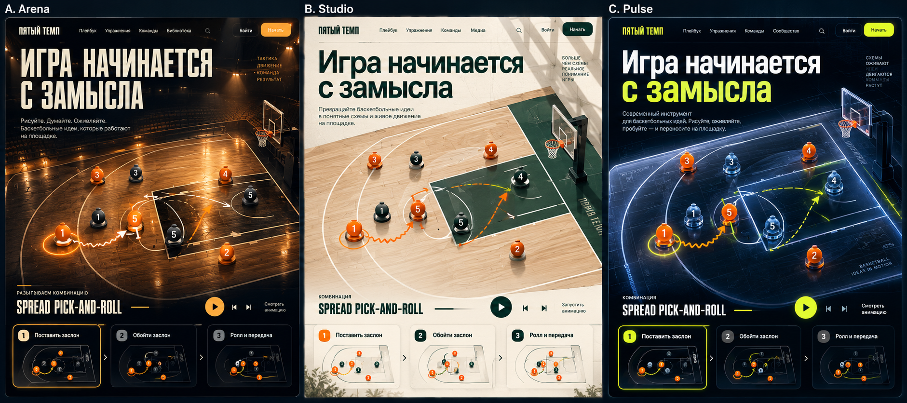
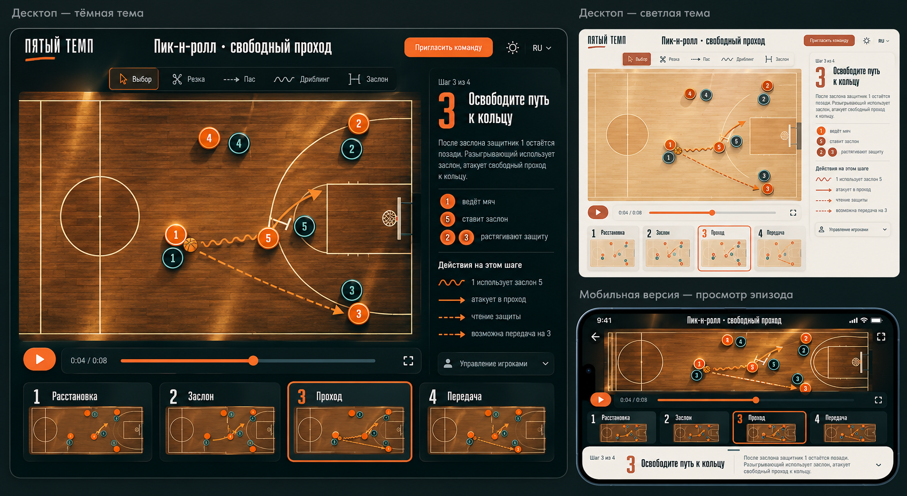
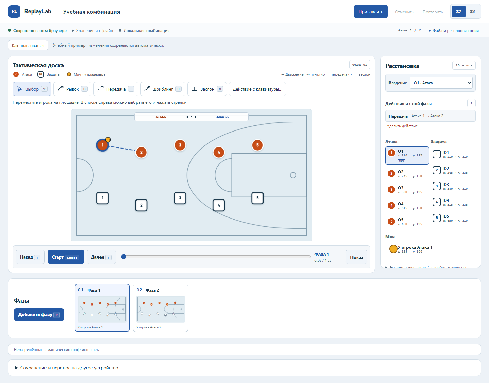
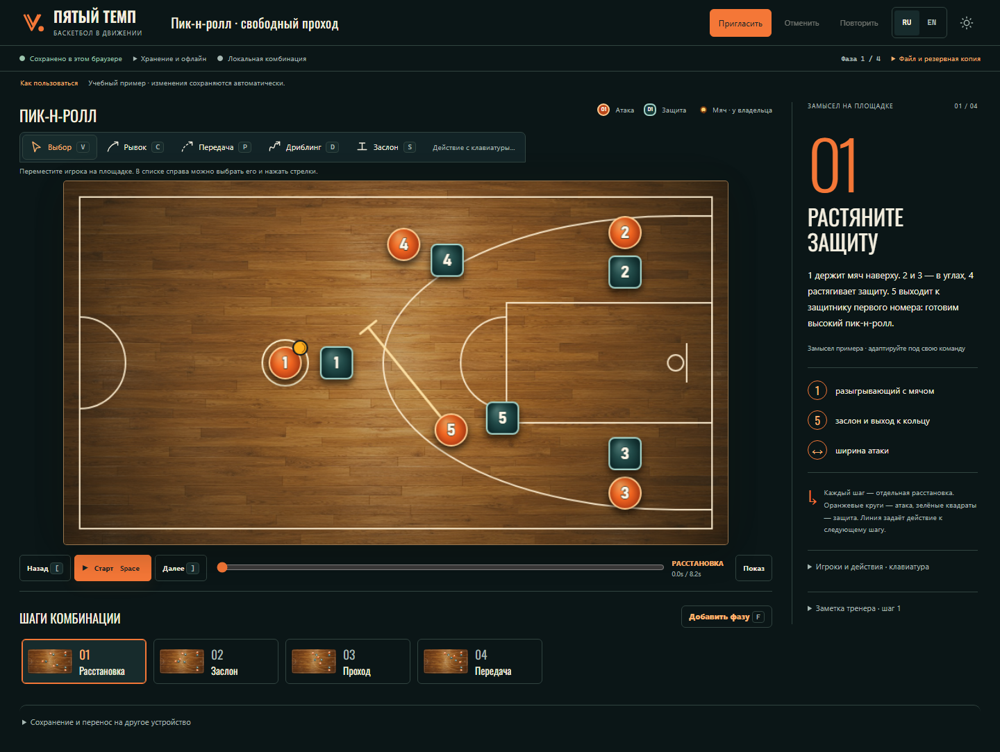
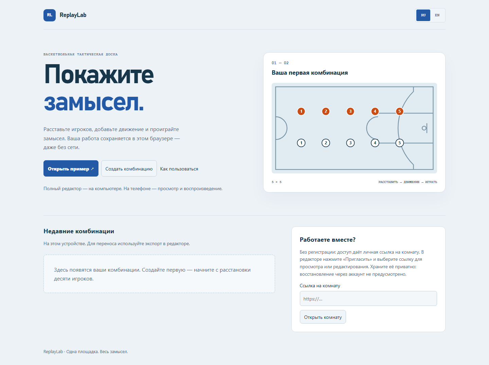
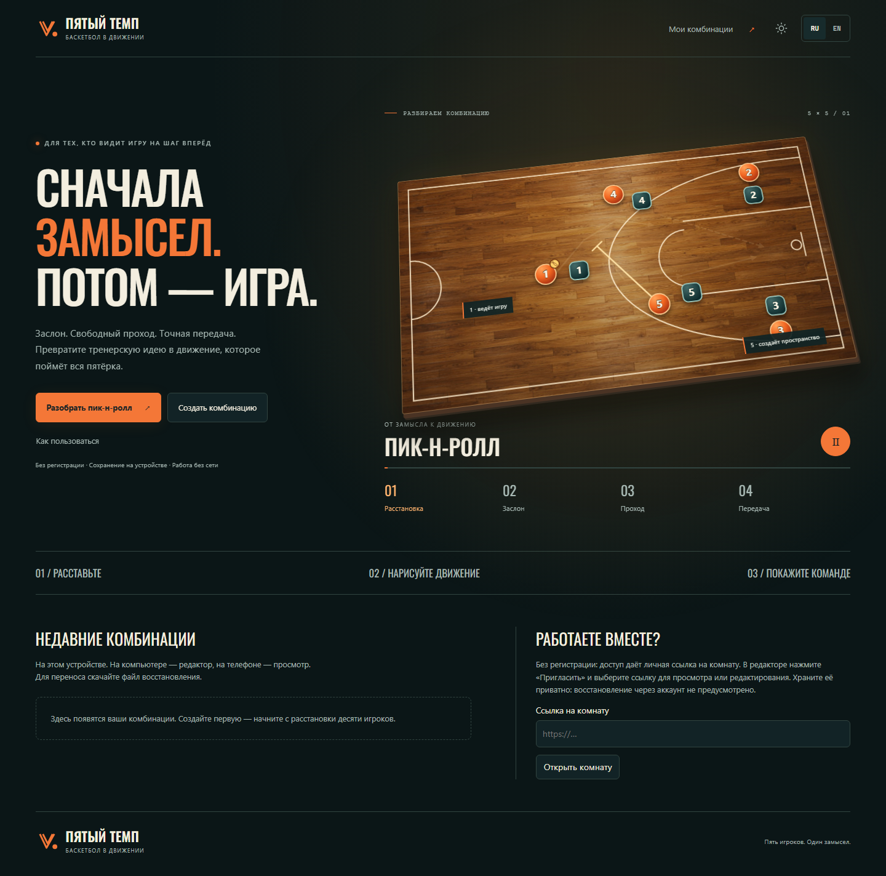
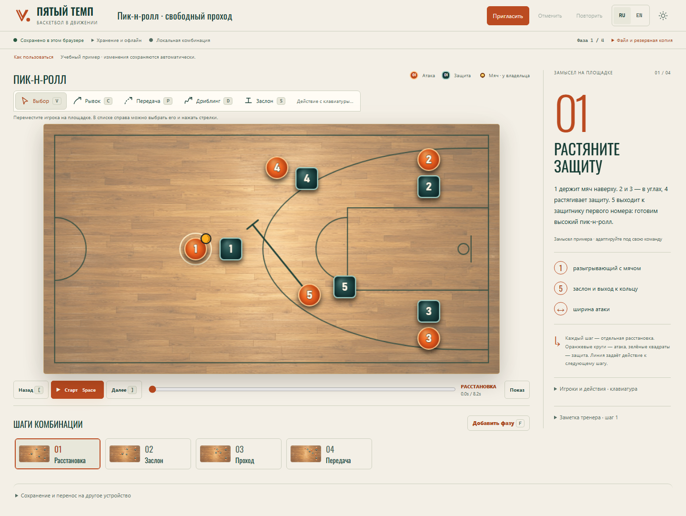
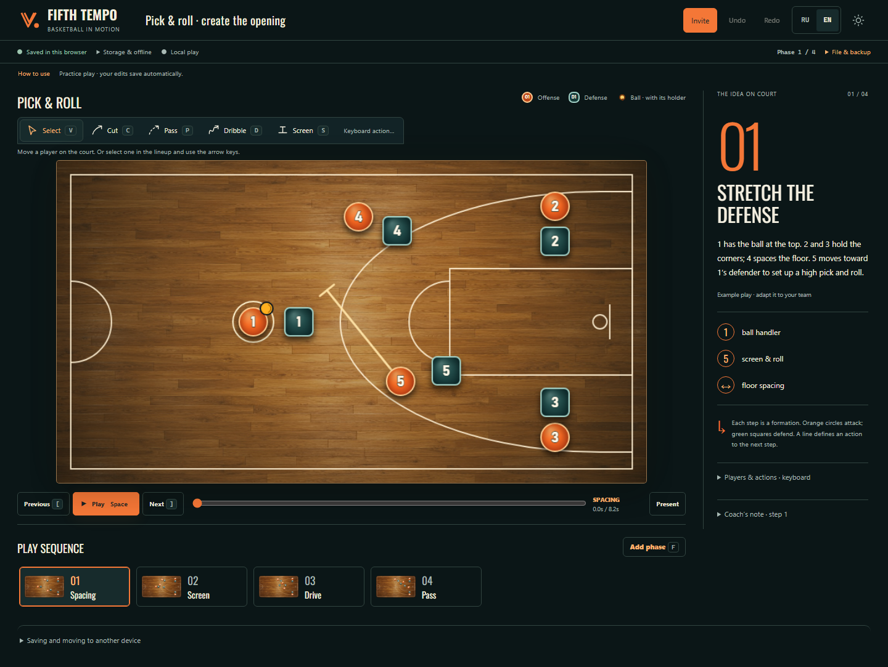
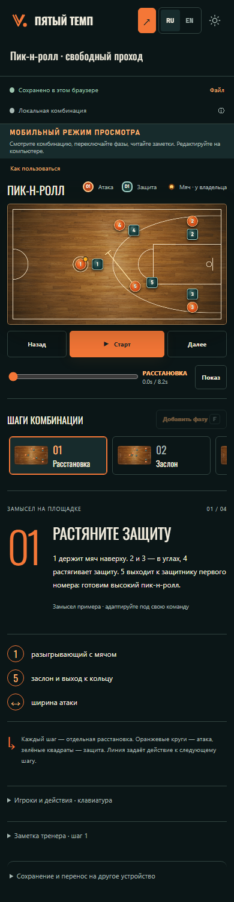
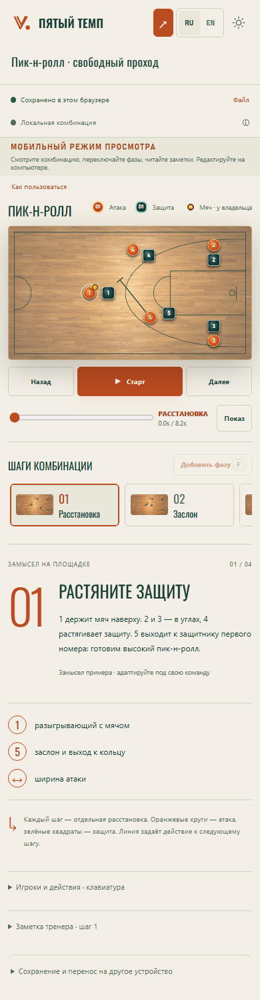

# Пятый темп · real screens and references

Published 2026-10-17 on the [existing Render service](https://replaylab-godaylor.onrender.com/).
[Actual public editor](public-arena-editor.png) · [Actual public home](public-arena-home.png)
· [Deployment receipt](public-arena-render.jpg). [CI/public checks and limits](../PRODUCTION_VERIFICATION.md).

The previous daylight interface was rejected by the owner. This revision changes
the basketball example, the action-to-playback workflow and the visual system.
All screenshots below are actual browser output; the concept boards are clearly
separated from them. [Product/architecture decisions](../ARENA_REWORK.md).

## Three visual directions

Selected: **Arena**, with Studio's warm paper/forest palette for light mode.
[Exact prompts and asset provenance](ARENA_PROMPTS.md).

## Coherent mockups

The implementation deliberately uses one half-court, ten players and a compact
horizontal step rail. The generated board's full-circle/extra court-line
inaccuracies are not reproduced. The main editing projection stays flat for
accurate pointer and keyboard control; only the Home demonstration has depth.

## Before and after · 1440 × 1000 viewport

| Rejected daylight interface | Implemented Arena interface |
| --- | --- |
|  |  |
|  |  |

The editor's new court is approximately 959 × 525 CSS pixels at this viewport.
The timeline ends at about y=993. The 1265 × 712 transport fits without needing
to search below the viewport. The source of truth for exact bounds and overflow
is each `arena-*-geometry.json` capture, plus the reflow tests.

## Light theme

## English interface

## Phone review

| Dark | Light |
| --- | --- |
|  |  |

Phone mode keeps playback, scrubbing, named steps, the coach's note and the
semantic lineup/action view. Authoring remains a desktop capability. Tablet
keeps actor repositioning/cue editing and uses 44-pixel controls.

## Motion and browser evidence

[30-second recording of the actual app](arena-motion.webm): animated opening
scene → full pick-and-roll → keyboard move/undo → light theme. The recording is
made from the production server in a fresh installed Google Chrome profile.
It is not an image-generated video or a simulated UI.

[Browser check](arena-browser-check.json) states the exact browser/version,
origin, HTTP failures and scope. This does not test the owner's existing Chrome
extensions/profile or a Russian connection/VPN pair. Screenshot capture disables
finite entrance animations only while taking the image, so that references do
not capture an unfinished fade. Live animations remain enabled unless the user
requests reduced motion or pauses playback.

## Verification and limits

[Current actual test and publication results](../PRODUCTION_VERIFICATION.md).
Automated accessibility checks and keyboard scenarios do not replace a manual
screen-reader review or physical-device testing. Both remain explicitly open.
