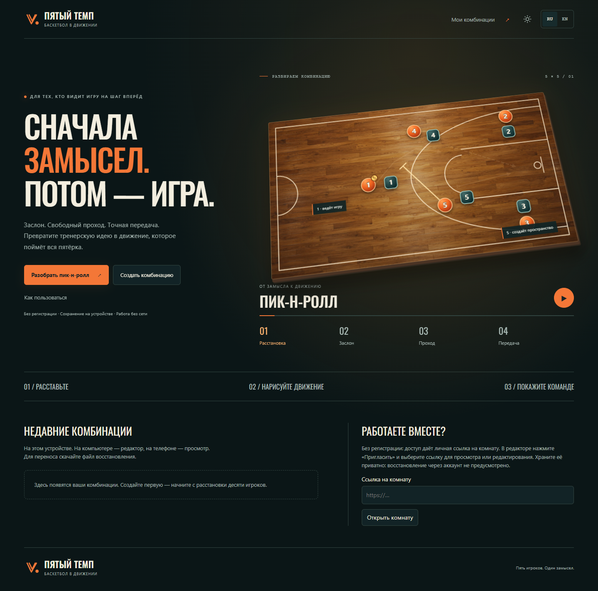
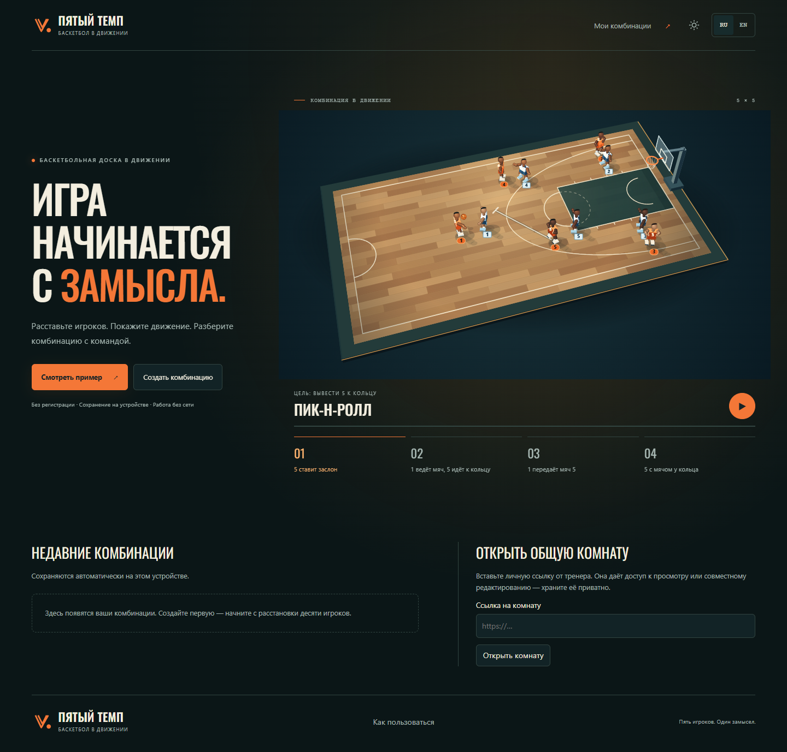
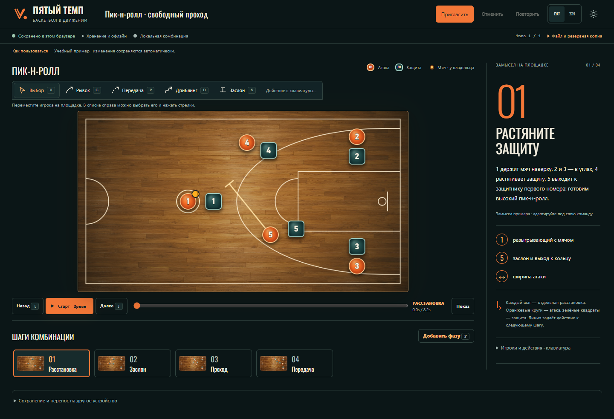
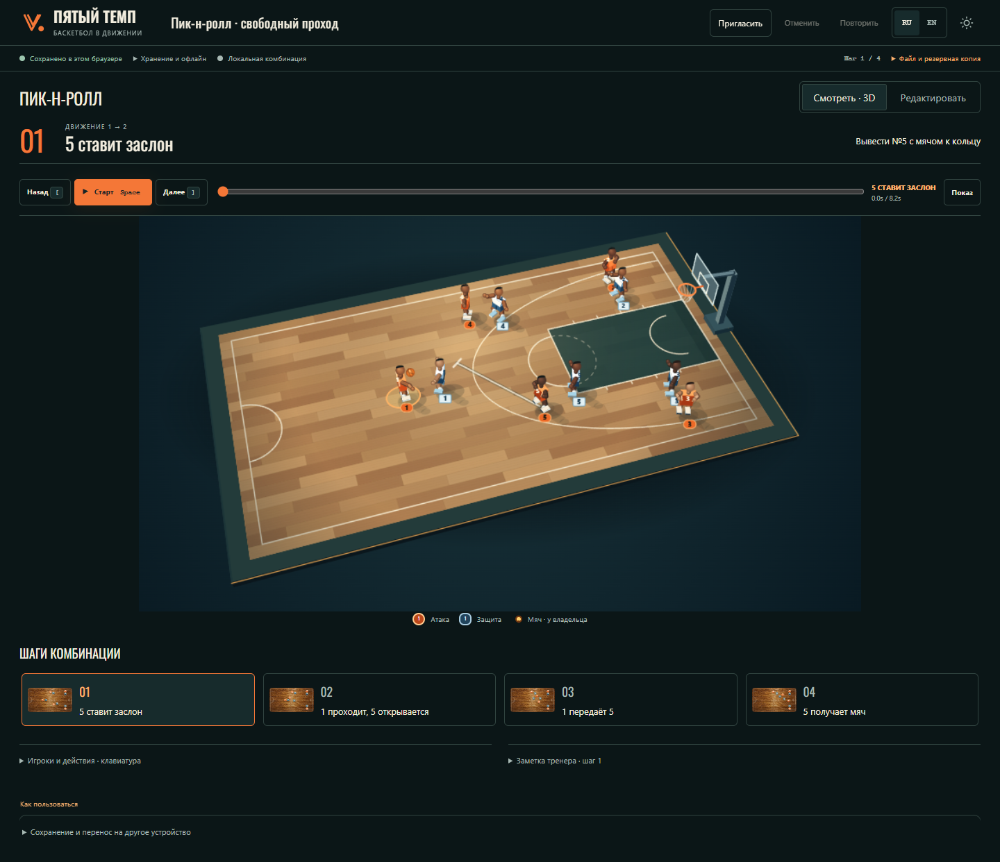
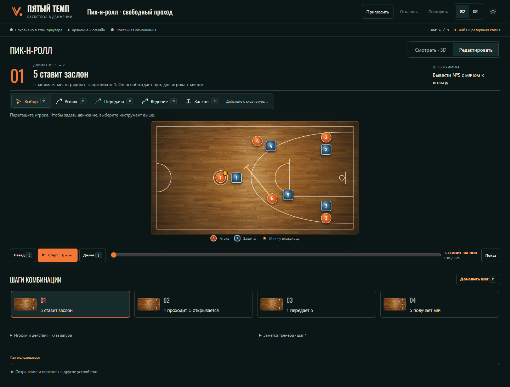
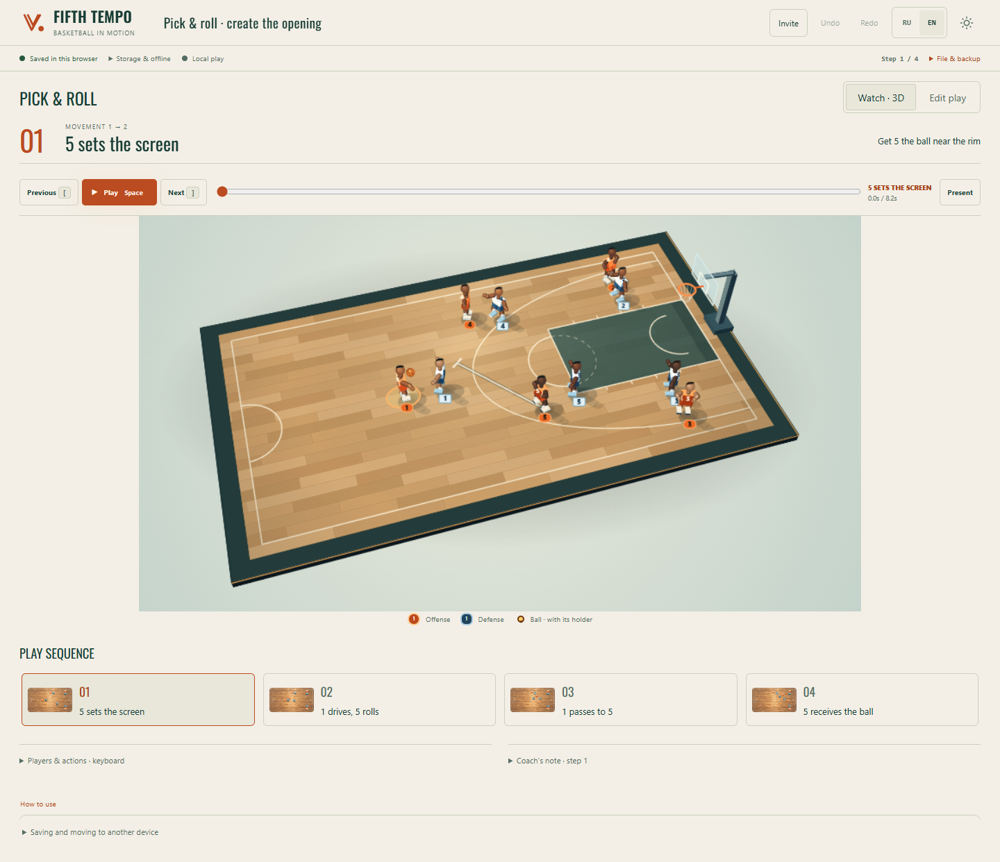
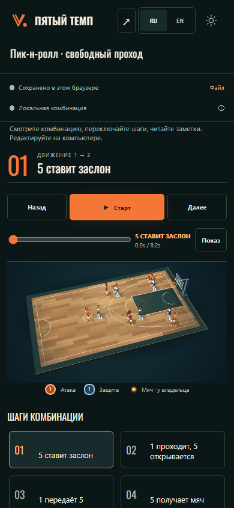
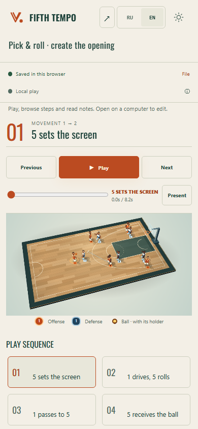

# Coach workbench: actual screens and practical review

Reviewed locally on 2026-10-17. The old preview at `127.0.0.1:32400` supplied
the before captures; the development application at `127.0.0.1:32420` supplied
the after captures. Every application screenshot below is actual browser output.
Publication and release checks are recorded separately in
[Production verification](../PRODUCTION_VERIFICATION.md).

[Actual 32-second motion recording](coach3d-motion.webm) shows the verified
package on `127.0.0.1:32400`: live homepage → Watch → playback/pause → Edit →
Watch. It is captured in installed Chrome 155 at 1440 × 900, not generated video.
[Capture metadata](coach3d-motion.json) records duration, steps and zero captured
browser/request errors. It is a demonstration, not human approval or a field study.

## What changed for the coach

The opening action is **Watch example**. It opens a separate local example in
3D review, showing a concrete goal and the next player's movement. **Edit play**
switches to an accurate overhead board with drawing tools. The same original
pick-and-roll data drives the homepage, 3D playback and editable plan.

The visible sequence describes outgoing movement: **5 sets the screen →
1 drives, 5 rolls → 1 passes to 5 → 5 receives the ball**. This replaces labels
that named an arrived formation while the arrows showed the following movement.
The interface calls these **steps**, while existing document fields and IDs keep
their original schema. Choosing a presentation does not create a new document.

A final manual pointer exercise found another misleading state: after editing
or deleting an example action, the timeline and transport could still show its
original demonstration caption. Caption selection now checks the actual poses,
possession, adjacent action set and paths. Edited steps use current movement
descriptions and neutral step labels; appending removes the former endpoint's
finish caption. RU/EN regressions verify deletion, destination changes, append
and undo while preserving a trainer's custom note.

## Reference and implementation

This generated image establishes the warm court, dark background, orange accent,
condensed typography and shared 3D scene across entry, review and phone screens.
It is a visual reference, not a screenshot or a claim about implemented features.
Its invented counters, statistics, account controls and navigation are not product
features and were not copied into the application.

The implementation uses original procedural 3D court/player geometry projected
onto Canvas. Players are stylized, not photorealistic. The hoop, team colors,
numbers, ball and movement paths are drawn from the actual play; no generated
bitmap substitutes for an interactive court. Editing keeps the overhead view so
pointer coordinates and keyboard movement remain predictable.

## Before and after

| Previous published design, local preview | New workbench, local development |
| --- | --- |
|  |  |
|  |  |

The homepage and review now use the same renderer. The old homepage's tilted
flat diagram no longer promises a different visual experience from the editor.
The main review shows the current action beside a large court; playback controls
are above it so they remain available in shorter windows.

## Editing and compact desktop

[Compact editor, 1024 × 768](coach-3d-compact-ru-edit.png) ·
[Compact 3D review](coach-3d-compact-ru-watch.png) ·
[Compact homepage](coach-3d-compact-ru-home.png)

A narrow window with a mouse or trackpad keeps the full authoring controls.
The visual pass confirmed that drawing tools and Add step are available at
1024 px. At 1440 × 1000, after adding a step, the court started at y=342.05 px
and the timeline ended at y=975.03 px. The root font was 16 px. At shorter or
narrower desktop sizes the document can scroll vertically; controls are not
removed solely because the window is narrow.

## English and light theme

[English light homepage](coach-3d-en-light-home.png) ·
[English light editor](coach-3d-en-light-edit.png)

## Phone review and screenshot iteration

| Russian, dark | English, light |
| --- | --- |
|  |  |

[Russian phone homepage](coach-3d-mobile-home-ru.png) ·
[English phone homepage](coach-3d-mobile-en-light-home.png)

The first review found excessive space above the mobile court and a four-step
horizontal strip that concealed later steps. The revised phone layout removes
the duplicate court title and one-option view switch, shortens the mode notice,
and lays out all four step cards in a two-column grid. The Russian court now
starts at y=435.41 px rather than y=515.41 px; the English court starts at
y=420.41 px. The court is 366 × 200.42 CSS pixels at a 390 × 844 viewport.
The remaining detail/notes and recovery controls are available below the fold.

## Observed checks

The [machine-readable visual evidence](../../packages/replaylab/foundation/evidence/coach-visual-review.json)
records viewports, input media, control availability, court bounds and errors.

| Check in isolated example documents | Result |
| --- | --- |
| Homepage, Watch and Edit at 1440 × 900 in installed Chrome | Captured; no page overflow or JavaScript/resource errors |
| Narrow mouse/trackpad desktop at 1024 × 768 | Desktop authoring retained; Add step enabled |
| Watch → Edit and adding a step at 1440 × 1000 | Completed; timeline remained within the viewport |
| Play and pause in Russian and English | Completed in desktop and phone review |
| Phone at 390 × 844, touch input | `coarse=true`, mobile mode, editing controls absent |
| Revised phone steps | Two-column grid; no horizontal page overflow or horizontal card clipping |
| Dark Russian and light English screens | Captured and visually inspected |

This was a practical simulation of opening, reviewing and editing a play, not
a study with a basketball coach in a live training session. It did not establish
physical-phone behavior, screen-reader usability, VPN behavior, or access from
Russia. Persistence, offline recovery, collaborative convergence, complete
keyboard flows and publication need their own release evidence; screenshots
alone do not prove those properties.

An automation issue was isolated during capture: full-page screenshots reset
the emulated coarse-pointer state. Those phone observations were discarded.
Final phone evidence uses viewport screenshots and explicitly verifies coarse
input, mobile mode and the absence of authoring controls. Desktop screenshots
include the full page. Finite entrance animations are disabled for still captures.

The procedural players are smaller and less detailed than the generated visual
reference, particularly on a phone. Their numbers and movements have a semantic
DOM companion, but actual coach feedback and physical-device review remain
necessary before claiming field usability.
