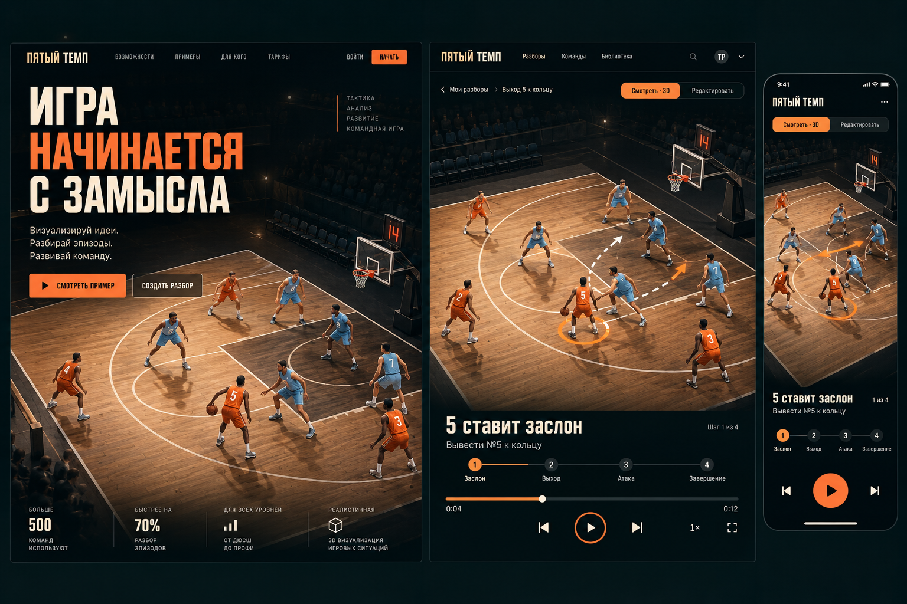
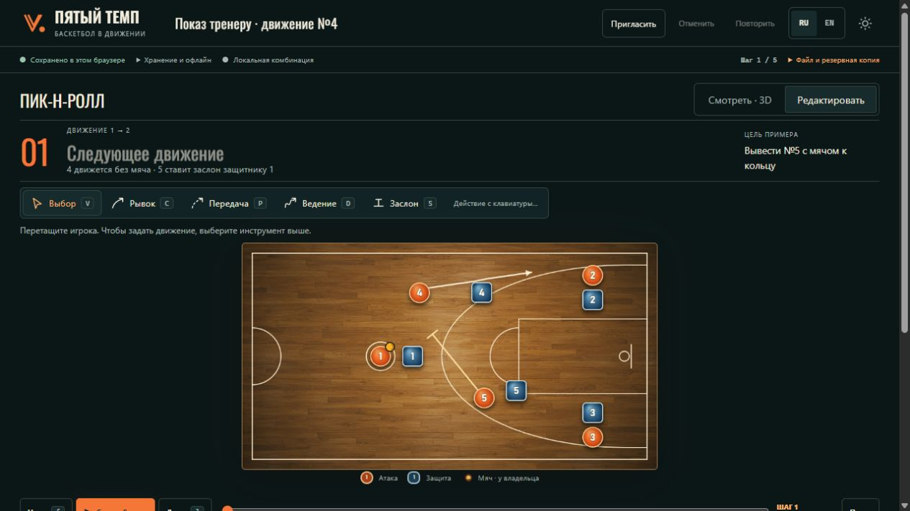
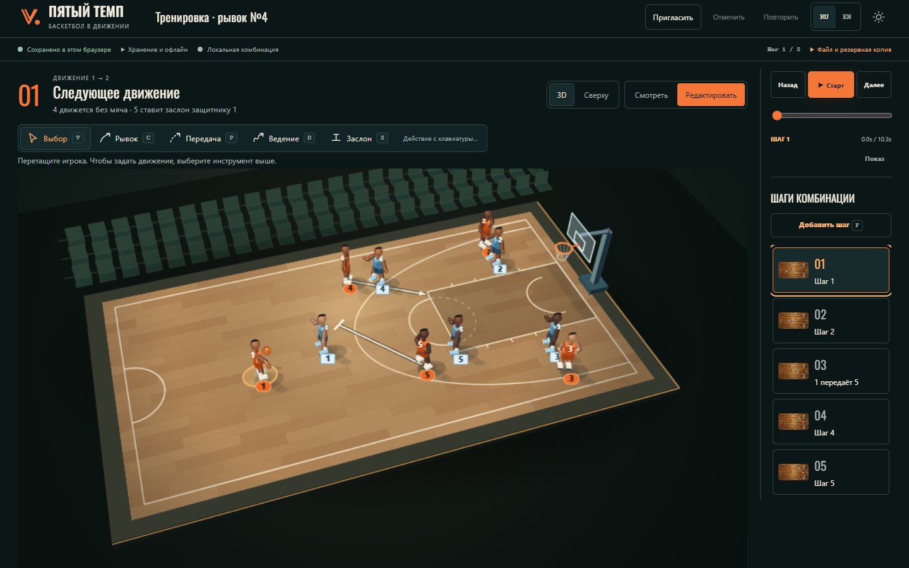
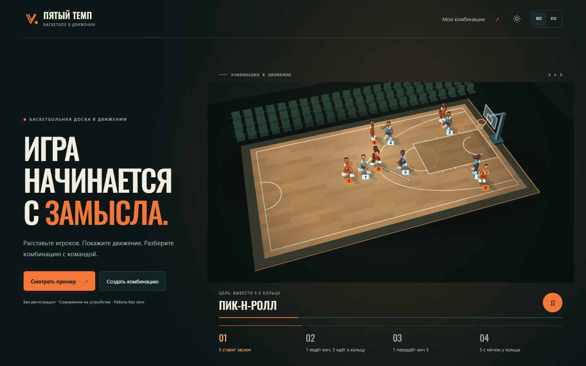
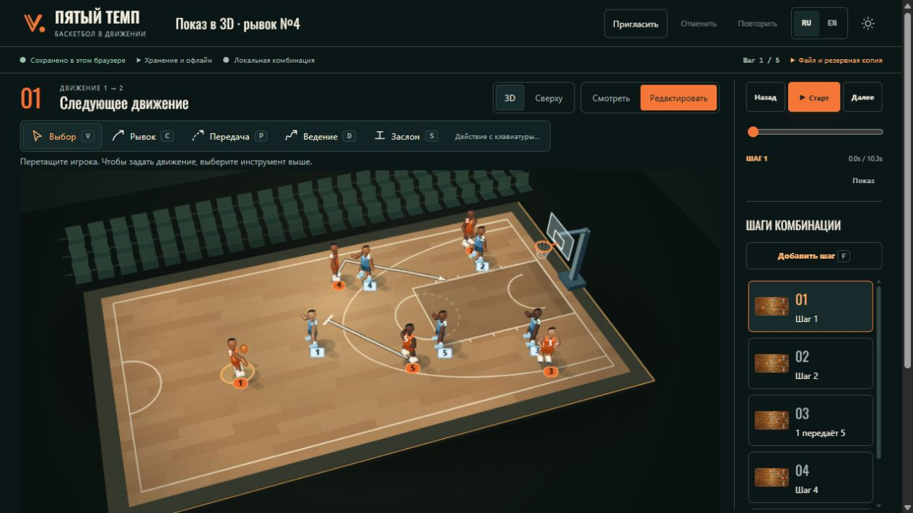
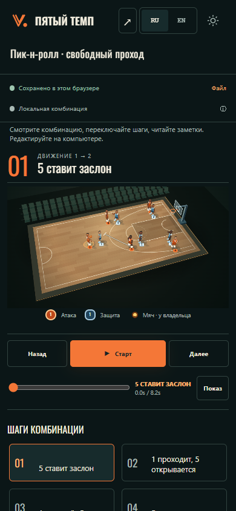
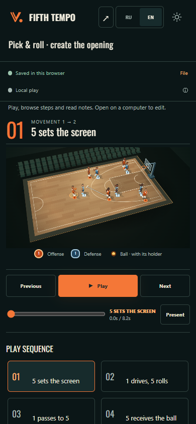

# Прямое редактирование в 3D — сравнение и практический проход

18 октября 2026 года. Прежний режим просмотра показывал объёмную площадку,
но «Редактировать» принудительно возвращал тренера к плоской схеме. Это было
продуктовое решение, а не техническое ограничение. Теперь игрока можно взять
за фигуру, переместить и нарисовать движение на той же 3D-площадке.

**Проверенная публикация:** `7fbb35b2ceb2cad59884e67a96b9f7338797b1c4`, Render
`dep-dba0ta7btjjs73dc1kc0`. Видео, настольные и мобильные экраны заново получены
с этой версии. Перед записью проверено совпадение публичных HTML, JavaScript и CSS
с проверенным пакетом. [Отчёт записи](direct3d-coach-demo.json) содержит точный
коммит, идентификатор публикации, браузер, проверки и хеш видео. История отдельного
ручного документа IAB оговорена ниже.

## Макет и оставшийся визуальный разрыв

Макет показывает реалистичных спортсменов, сложное освещение и подробную фактуру
арены. Рабочая сцена остаётся стилизованной: фигуры, материалы и тени проще.
Камера показывает всю площадку, поэтому игроки меньше, чем в близком ракурсе
макета. Фотореалистичное совпадение с ориентиром не достигнуто.

| Элемент | Прежняя опубликованная версия | Прямое редактирование в 3D |
|---|---|---|
| Перемещение игрока | Переход из красивого просмотра к плоской доске | Захват видимой фигуры на той же сцене, без скачка к месту нажатия |
| Рисование движения | Только вид сверху | Путь начинается у выбранного жестом игрока и рисуется по паркету |
| Вид и режим | 3D было связано только с просмотром | «3D / Сверху» и «Смотреть / Редактировать» независимы |
| Размер рабочей сцены | Редактор уменьшался сильнее просмотра | Общая большая площадка для обоих режимов |
| Воспроизведение и шаги | Управление уходило ниже площадки | На широком экране запуск и последовательность находятся справа |
| Визуальная точность | Фотореалистичный макет, существенно более простая реализация | Компоновка и взаимодействие приблизились к замыслу; реализм материалов и фигур остаётся ограничением |

## До: редактирование принудительно становилось плоским

## Реальная опубликованная сцена, 1440 × 900

На этом экране видны вся площадка, обе группы переключателей, «Старт» и все
пять карточек. №1 перемещён, от №4 нарисован рывок, комбинация автоматически
сохранена в браузере. Клавиатурный список игроков и заметки остаются доступными
ниже основного рабочего пространства.

## Полный путь на конкретной комбинации

[Непрерывная запись опубликованного приложения — 37,72 секунды](direct3d-coach-demo.webm)
и [машиночитаемый отчёт](direct3d-coach-demo.json) относятся к исправленной версии
`7fbb35b`. Это фактически измеренная длительность файла, 1440 × 900, Chrome
155.0.8059.80. Запись выполнена на новой локальной комбинации после публикации.

| Отметка в журнале прохода | Видимое действие |
|---|---|
| 4,44 с | С главной открыт готовый пример с четырьмя шагами |
| 6,19 с | Включено редактирование; объёмная площадка сохранена |
| 7,35 с | Название изменено на «Тренировка · рывок №4» |
| 10,39 с | №1 перемещён за корпус фигуры к позиции около `(230, 255)` |
| 14,78 с | От №4 нарисован рывок к `(555, 160)` следующего шага |
| 16,42 с | Добавлен пятый шаг |
| 17,77–28,26 с | Комбинация воспроизведена с начала до конца |
| 29,49–33,61 с | Возврат на главную, открытие из недавних, перезагрузка |

В этом проходе название, пять шагов, позиции и полный путь совпали с сохранённым
документом после повторного открытия и перезагрузки. Предпросмотр жеста и
воспроизведение не изменяли канонический документ. JavaScript-ошибок, ошибок
загрузки ресурсов и неуспешных запросов во время записи не было. Это результаты
именно записанного маршрута. Отдельно прошёл расширенный публичный сценарий
RU/EN: отмена и повтор действия, перезагрузка, открытие из недавних и запуск
закрытой ранее вкладки без сети; две независимые совместные сессии с отключением,
параллельными правками, восстановлением связи и локальной отменой; восстановление
комнаты в новой сессии и отдельная ссылка только для просмотра.

## Отдельный ручной проход в браузере приложения

В отдельной новой локальной комбинации «Показ в 3D · рывок №4» выполнены
перемещение №1 примерно к `(204, 256)`, рисование рывка от №4, добавление пятого
шага и полное воспроизведение комбинации длительностью 10,3 секунды. Затем
комбинация открыта из недавних и перезагружена. Это самостоятельный проход через
видимые элементы браузера, отдельный от записи Playwright. Документ создан ещё
на первой публикации `ccdf209`. После обновления до `7fbb35b` проверены окончательные
ресурсы приложения, сохранённые название, пять шагов, рывок №4 и позиция №1;
комбинация снова проиграна до шага 5/5 и открыта из недавних. Это проверка сохранения
ранее созданного документа при обновлении, а не заявление о его новом создании
на окончательной версии.

В коротком окне 1265 × 712 передний край площадки требует прокрутки страницы.
«Старт» остаётся в правой колонке, а карточки шагов прокручиваются внутри списка;
все пять карточек одновременно в таком окне не помещаются. Это оставшийся
компромисс между размером игроков и помещением всей сцены по высоте.

## Мобильный просмотр

| RU, 390 × 844 | EN, 390 × 844 |
|---|---|
|  |  |

На узком экране блоки идут последовательно: площадка, воспроизведение, шаги.
Телефон предназначен для просмотра, запуска и выбора шага; полноценное
редактирование остаётся настольным сценарием. Эти снимки сделаны в сенсорной
эмуляции Chrome, а не на физических телефонах. Повторная проверка окончательной
публикации RU/EN прошла: запуск и пауза воспроизведения, выбор шага касанием,
неизменность документа, отсутствие горизонтального переполнения и сохранение языка
после перезагрузки. Ошибок браузера и загрузки ресурсов не было.

## Ошибка, обнаруженная практическим проходом

Первый публичный расширенный сценарий выявил, что завершение рывка поверх
видимого защитника ошибочно передавало целевого игрока в команду. Рывку и ведению
нужна точка площадки; целевой игрок нужен передаче и заслону. Исправление вошло
в `7fbb35b`. Регрессионный сценарий проверяет оба типа действия, неизменность
документа во время рисования и отмену одним действием. Расширенный сценарий на
исправленном публичном сайте также прошёл: путь и позиция следующего шага совпали
после отмены, повтора, перезагрузки и повторного открытия.

Показ воспроизводит тренерское задание в браузере. Это не полевая оценка тренером,
не проверка физических телефонов и не доказательство доступа из России либо
проверки VPN/без VPN. Визуальное различие с фотореалистичным макетом сохраняется.
