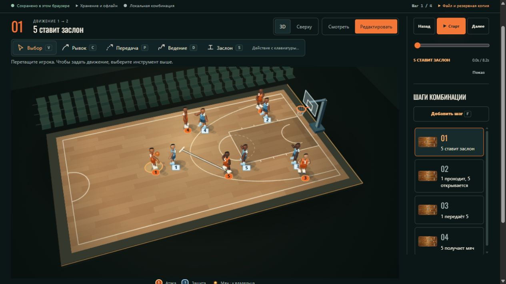

# Прямое редактирование в 3D — сравнение

Владелец указал на разрыв между объёмным макетом и рабочим редактором. Причина
была в продуктовом решении: прежний Watch показывал 3D, а Edit принудительно
переходил к виду сверху. Технической необходимости в таком разделении нет.

## Ориентир

Фотореалистичные материалы и анатомия макета не воспроизведены один в один.
Реализация использует собственную стилизованную объёмную геометрию, общую для
главной, просмотра и редактирования. Фигуры, материалы и тени проще; камера
показывает всю площадку, поэтому игроки меньше, чем в макете. Это оставшиеся
визуальные различия, а не достигнутое совпадение с референсом.

## До изменения

Реальный опубликованный экран после прохождения прежнего сценария: Edit
переключал тренера на плоскую схему.

## Проверка новой компоновки

На настольном экране площадка занимает основную колонку. Перемещение начинается
за фигуру игрока и сохраняет место захвата; инструменты рисуют на этой же сцене.
Справа постоянно доступны Старт, шкала времени, добавление и выбор шага. Вид
сверху выбирается отдельно от режима просмотра/редактирования.

В коротком окне 1265 × 712 передний край площадки требует прокрутки страницы;
управление воспроизведением остаётся в правой колонке. Список длинной комбинации
прокручивается самостоятельно. На узких экранах блоки идут последовательно:
площадка, воспроизведение, шаги. Клавиатурный список игроков и заметки сохранены.

Это проверка смоделированного тренерского задания, а не полевая оценка тренером.
Финальные опубликованные экраны и запись будут добавлены после проверки релиза.
