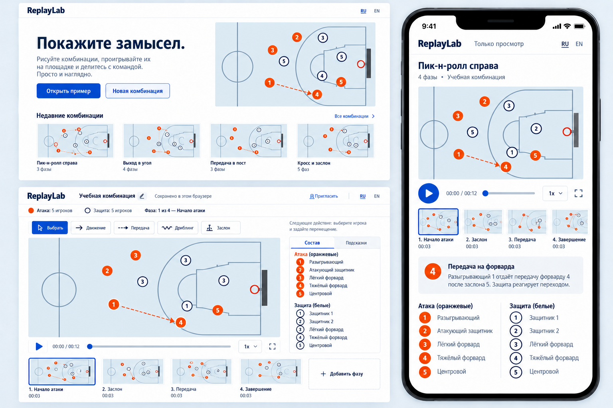
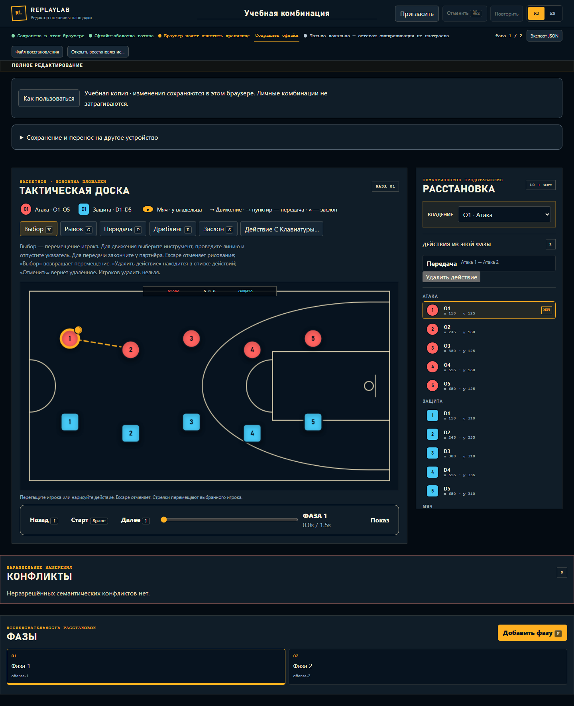
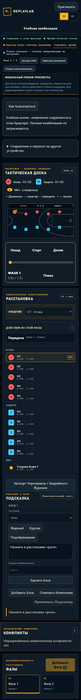
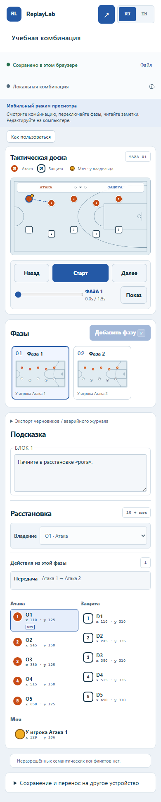
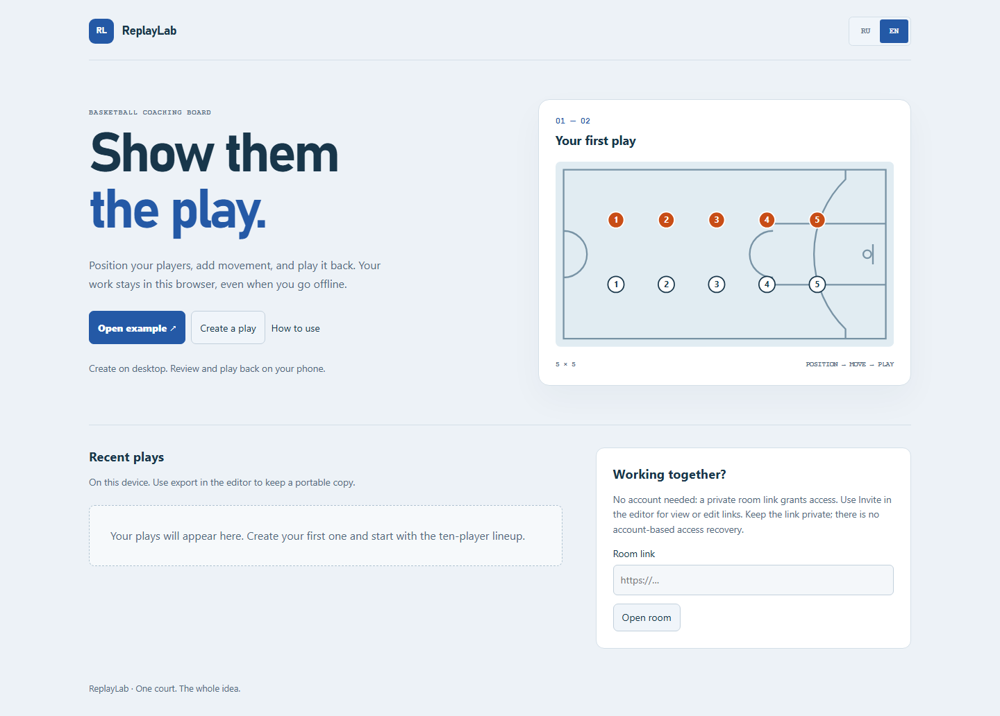

# Visual review

**Historical, owner-rejected daylight revision.** The current implementation,
new concepts, real dark/light/mobile captures and before/after comparison are in
[ARENA_REVIEW.md](ARENA_REVIEW.md). Do not treat this page's old “After” images as
acceptance of the current product.

Chosen concept: B, daylight court. [Generation prompts](PROMPTS.md).

## Actual application

The implementation preserves the original right-basket half court, five round offense players, five square defense players and the derived ball. Shapes remain distinct without relying only on color. Phase miniatures project the actual selected document, not canned preview images.

| Before | After |
| --- | --- |
|  |  |
|  |  |

## Corrections after comparing screenshots

- Moved the phase strip directly after the court/playback, ahead of the mobile semantic inspector.
- Reduced the masthead and practice explanation. Kept the court and phase filmstrip within the 1440×1000 initial desktop view.
- Moved offline retention and backup/export tools into named disclosures. Warnings and failed-save states remain explicit; recovery controls open when needed.
- Added contextual next-action guidance after moving, drawing and adding a phase.
- Compacted the phone masthead/status controls, kept playback prominent, and placed cue reading before the lineup visually on phones.
- Fixed closed-disclosure overflow and CSS grid minimum-size overflow at 320 px. Kept all existing responsive capability restrictions.
- Corrected light-theme contrast for conflicts and collaboration presence.
- Preserved a keyboard semantic lineup, roving phase navigation, focus return, native dialog behavior, reduced motion and forced colors. Automated review is not human screen-reader approval.

Intentional differences from generated references: the code retains correct existing court orientation, distinguishable round/square team shapes, real document capabilities and supported actions only. No generated statistics, fabricated recent plays or extra controls were implemented.
